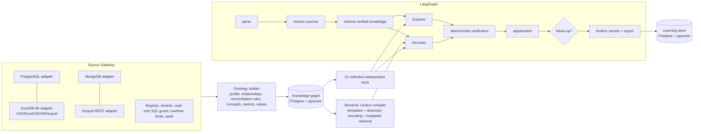

# Universal Data Reasoning Engine (UDRE)

A dual-path, evidence-grounded engine for asking questions of unfamiliar data sources. It discovers sources, profiles them, builds a persistent ontology and knowledge graph, and answers each question with two independent reasoning paths (Explorer and Hercules). Their candidates are checked with deterministic validators and adjudicated on observed evidence. Every answer comes with its query lineage, evidence records and verification status.

The flagship dataset is a fully synthetic, seeded financial warehouse modelled on the 39-table / 8-domain DBA reference. The engine itself contains **no table, schema or column names**. Everything it knows about a dataset is discovered through the same ingestion, profiling and ontology pipeline used for any source.

## Quick start

```bash
pip install -r requirements.txt
python scripts/build_dataset.py      # generate + load into PostgreSQL, export files, run invariants (all must pass)
python scripts/build_knowledge.py    # discovery, profiling, ontology/knowledge graph (incremental)
python scripts/run_demo.py           # end-to-end questions with lineage, validation, exports
python scripts/run_phase2_demo.py    # Phase 2: HubSpot + Intune ingestion (mock APIs), skill files, both agents, provenance
python -m pytest tests -q            # 74 tests
python scripts/run_benchmark.py --split all
uvicorn udre.api.app:app --port 8000 # HTTP API (see docs/API_EXAMPLES.md)
```

No PostgreSQL install is needed. If `UDRE_PG_URI` is unset, `udre/pg_embedded.py` starts a local PostgreSQL 16 with pgvector, using the binaries shipped in the `pgserver` wheel. The data lives in `.pgdata/` and the server keeps running between processes; stop it with `python -m udre.pg_embedded stop`. No LLM credentials are required: without them the engine runs in an explicit, labelled deterministic offline mode.

**Phase 2** added the database-investigation skill with versioned per-collection reference files, LLM tool-calling for both agents (Anthropic Messages / OpenAI-compatible, including Azure AI Foundry), Microsoft Intune and HubSpot connectors on a common ingestion pipeline, cross-source candidates and adjudication fixes. See [docs/PHASE2.md](docs/PHASE2.md) for what is implemented, how it was tested, benchmark changes and what still needs credentials.

## Architecture



| Component | Module | What it does |
|---|---|---|
| Source gateway | `udre/gateway/` | `DataSourceAdapter` interface (discovery, schema, profiling, sampling, value search, execution, EXPLAIN, fingerprint). PostgreSQL (pooled, read-only transactions, statement timeout), DuckDB file adapter, MongoDB (native pipelines), and a REST adapter that only reaches allow-listed hosts. `sql_guard.py` enforces single read-only statements, blocks file/sleep/admin functions, allow-lists tables and bounds rows. `registry.py` handles tenant/user authorization, collection deny-lists and the audit log. |
| Ontology builder | `udre/ontology/builder.py` | Batched profiling (2 queries per collection). Builds Source/Collection/Column nodes. Declared foreign keys are checked with orphan and fan-out queries. Inferred foreign keys need name match, a unique parent and 100% value containment before they count as verified. Reconciliation rules (`parent = SUM(child)`) are discovered by executing the check. Concepts, metrics, dimensions and value mappings come from terminology packs. |
| Knowledge graph | `udre/ontology/graph.py` | Relational node/edge/evidence tables with pgvector embeddings. Every node and edge carries provenance, evidence references, verification status, schema version, confidence and last-validated time. `promote()` refuses to mark anything verified without stored deterministic evidence. Schema fingerprint changes mark old knowledge `stale_schema`. Recursive-CTE traversal is supported. |
| Terminology pack | `udre/domain_packs/finance.yaml` | Business vocabulary and metric *shapes* expressed in concepts only, never physical names. Bindings to real columns are discovered at runtime. |
| Context compiler | `udre/compiler/semantic_compiler.py` | Shared column dictionary, schema templates, deduplicated value dictionary, compact column codes, truncated samples. Measures bytes and tokens with tiktoken. Budgeted, relevance-ranked rendering. Recompiles incrementally per source version. |
| Tools | `udre/skills/tools.py` | `discover_sources`, `discover_collections` (skill retrieval), `describe_collection`, `inspect_column`, `search_column_values`, `sample_rows`, `explore_relationships`, `lookup_knowledge`, `execute_query`, `explain_query`, `compare_results`, `export_results`. `ToolSession` requires an objective per call, enforces a call budget and records `ToolObservation`s. |
| Planner | `udre/agents/planner.py` | Turns a question into a typed `QueryPlan`: aggregation; IDF-weighted measure scoring; value grounding against observed values; exclusion, null-intent and time filters; group-by through the exact FK named; N:1 join paths that prefer non-null keys; ambiguity flags. Compiles to dialect-correct SQL. |
| Explorer | `udre/agents/explorer.py` | Bounded DISCOVER → GAPS → INSPECT → QUERY → OBSERVE → VERIFY → ANSWER loop. Knows nothing up front: schema comes from tool calls and filters from live value search. Repairs failed queries, verifies filter presence and recomputes at primary-key grain. |
| Hercules | `udre/agents/hercules.py` | Starts from the full compressed context, decoded into its own catalog view, with its own scoring weights (metric definitions and concept aliases, no column descriptions). Checks missing values and scope against live data. Never sees Explorer state. |
| Validators | `udre/verification/validators.py` | Syntax and column existence, source binding, execution, join multiplicity (measured), null handling (rows dropped by inner joins), currency mixing, date/period coverage, filter grounding (row counts), nullifying statuses such as VOID/REVERSED (measured impact), reconciliation through discovered rules, debit = credit. |
| Adjudicator | `udre/verification/adjudicator.py` | Agreement is decided on executed values. Disagreements are localized (measure, filters, joins, grouping) and probed with discriminating queries. A winner needs a clear evidence-score margin; otherwise the answer is an explicit abstention listing both alternatives. |
| Orchestration | `udre/orchestration/workflow.py` | LangGraph with Explorer and Hercules in one superstep, writing disjoint keys (concurrent writes to one key raise `InvalidUpdateError`; see the test). Uses checkpointing (`InMemorySaver`), retry policies for transient database errors, conditional targeted follow-up, and persistence/export on finalize. |
| Learning store | `udre/memory/learning_store.py` | Verified query templates, value mappings and failed query patterns, scoped by tenant and user, tagged with schema version, invalidated on change, retrieved by pgvector similarity. |
| Exports | `udre/export/exporter.py` | CSV, Excel (results + lineage sheet), JSON, and a Markdown report. Add formats with `register_exporter`. |
| API | `udre/api/app.py` | `/ask`, `/sources`, `/sources/{id}/collections[/{c}]`, `/query`, `/sources/upload`, `/sources/{id}/refresh`, `/knowledge/stats`, `/knowledge/search`, `/export`, `/exports/{file}`. |

## Synthetic dataset

* `udre/synthetic/schema_spec.py` maps all 39 DBA tables onto 8 fictional schemas (`agreements`, `portal_app`, `master_ref`, `ledger_erp`, `pipeline_crm`, `fpna_plan`, `exec_reporting`, `data_ops`). It also generates the DDL (`sql/postgres_ddl.sql`: primary keys, foreign keys, indexes, comments) and the mapping document (`docs/SCHEMA_MAPPING.md`).
* `udre/synthetic/generator.py` derives every table from one event model: deal → won agreement → monthly invoices → cash, credit and write-off events → double-entry vouchers → budgets and reporting snapshots. Money is tracked in integer cents. Seed `20261023` gives byte-identical output (tested).
* Built-in edge cases include multi-currency invoices with FX, partial payments, credit memos, write-offs, VOID invoices, the legacy `CLOSED` status code, unmapped debtors and contracts, duplicate CRM accounts, reversed and pending vouchers, legacy CRM stage labels, a legacy account split across two modern accounts, three FKs from one table to the same dimension table, and allocation-weighted cost mappings.
* `udre/synthetic/ground_truth.py` defines 9 SQL invariants (all hold with zero violations) and 34 benchmark questions whose expected answers are computed from the event model in Python and cross-checked against SQL.
* The dataset contains no real names, identifiers or vendor terms. The internal DBA reference file is deliberately excluded from git.

## Benchmark results

Raw output is in `benchmark/*.json` and `benchmark/*.md`. Read these results with three caveats:

1. **No LLM was configured.** Both agents ran the deterministic planner, so "context tokens" counts context and tool-observation tokens processed, not model tokens.
2. **The `heldout` split was used for development after its first run.** It was scored once (84.6% answer accuracy, 15.4% wrong-but-confident, and dual+memory crashed on a bug). Two general join bugs and the memory bug were then fixed, after which it scored 100% in all four configurations. The post-fix figure is therefore not a generalization estimate. The first run is preserved in `benchmark/RESULTS_heldout_first_run.md`.
3. **The `heldout2` split was written after those fixes and scored exactly once, without changes.** It is the honest generalization number below.

| heldout2 (scored once) | Explorer only | Hercules only | Dual path | Dual + memory |
|---|---|---|---|---|
| Answer accuracy (9 answerable) | 0.667 | 0.778 | 0.667 | 0.667 |
| Schema-linking accuracy | 0.778 | 0.889 | 0.778 | 0.778 |
| Value-linking accuracy | 1.0 | 1.0 | 1.0 | 1.0 |
| Wrong-but-confident rate | 0.333 | 0.222 | 0.222 | 0.222 |
| Abstained on the ambiguous question | yes | yes | yes | yes |
| Unnecessary abstention rate | 0 | 0 | 0.111 | 0.111 |
| Avg tool calls | 29.8 | 8.0 | 37.8 | 37.8 |
| Latency p50 / p95 (ms) | 868 / 1170 | 219 / 439 | 1368 / 1742 | 1927 / 2425 |

What the failures show:

* **N02:** "issued *by* legal entity X" was parsed as a group-by. The number was right, but the answer came back as a grouped shape.
* **N04:** "by product line" was not applied as a grouping.
* **N08:** Explorer summed rep quota instead of deal weighted ARR, while Hercules was right. The dual path abstained instead of answering wrongly, which is what the adjudicator is for.
* **Correlated errors:** Explorer and Hercules share one planner core without an LLM, so their mistakes are correlated (N02 and N04 were wrong in both). Their independence today comes from evidence gathering (tools versus compressed context), not from independent reasoning.

Other measurements:

* Dev split: 10/10 in every configuration.
* Source migration: the same dev questions, answered from the uploaded CSV/Parquet/Excel/JSON copy alone, scored 5/5 with **0 code changes** and 5.1 s onboarding (discovery, profiling and ontology).
* Compression: 101k → 25.8k tokens (74.6% reduction, 4.2×) for 45 collections across both sources.
* Ontology build: about 15 s for both sources; unchanged schemas are skipped.

Persistent memory produced no measurable accuracy gain on these splits and added roughly 500 ms of latency, because each newly learned pattern invalidates the cached compiled context.

## Status

**Implemented and tested**

* PostgreSQL and DuckDB file adapters (CSV/Excel/JSON/Parquet); scoped REST adapter (tested with an injected fetcher).
* SQL guard, tenant/collection authorization, row and time limits, audit log.
* Batched profiling; relationship and reconciliation discovery; knowledge graph with evidence-gated promotion and schema-change invalidation.
* Context compiler with token measurement and budgeted retrieval.
* The 12 tools.
* Explorer and Hercules agents, validators, adjudicator, targeted follow-up (currency and fan-out repairs).
* LangGraph orchestration with branch isolation, checkpointing and retries.
* Learning store with tenant/user scoping and invalidation.
* Exports in four formats; FastAPI service.
* Synthetic dataset with invariants and ground truth; benchmark harness; demo; 42 tests.

**Partially implemented**

* *MongoDB adapter*: written against pymongo, but not exercised; pymongo is not installed here and no MongoDB server is available.
* *LLM reasoning*: the typed contracts (`QueryPlan`, `AgentReasoningCandidate`, `AdjudicationDecision`) are designed for structured model output, but no model-backed planner is wired in, because no credentials were available. Both agents currently use the deterministic planner.
* *Targeted follow-up*: repairs only currency mixing and join fan-out.
* *Embeddings*: deterministic feature-hashing vectors stored in pgvector; a hosted embedding model would improve skill retrieval.
* *Memory*: patterns are injected into Hercules' context, and learned value mappings feed value grounding; neither improved accuracy on the current splits.

**Planned**

* Model-backed planners with separate prompts for Explorer and Hercules (Explorer: tool-calling loop; Hercules: compressed context in the prompt) behind the existing contracts, for genuinely independent reasoning.
* Phrase-level parsing for "by" (agent versus grouping).
* Cross-source federated joins.
* Real authentication instead of identity headers.
* A durable checkpointer (Postgres saver).
* Incremental re-profiling of only the changed collections.

## Extending

* **New source:** implement `DataSourceAdapter`, or subclass `SQLSourceAdapter` and provide `_run`, `discover_collections` and `describe_collection`. Register it with `gateway.register(adapter, tenants=[...])`, then call `builder.build(ctx, source_id)`.
* **New vocabulary:** add a YAML pack to `udre/domain_packs/` with concepts and synonyms and optional metric shapes. Use concepts only, never physical names.
* **New export format:** subclass `ReportExporter` and call `register_exporter`.

## Configuration

| Variable | Default | Purpose |
|---|---|---|
| `UDRE_PG_URI` | (embedded) | External PostgreSQL URI; the database name is replaced per use |
| `UDRE_DATA_DB` / `UDRE_KNOWLEDGE_DB` | `aethelgard_finance` / `udre_knowledge` | Data and knowledge databases |
| `UDRE_UPLOADS_DIR` / `UDRE_EXPORTS_DIR` | `data/uploads` / `exports` | File source and export locations |
| `UDRE_EXPLORER_MAX_STEPS` | 14 | Explorer budget (tool calls = 3 × steps) |
| `UDRE_HERCULES_CONTEXT_TOKENS` | 32000 | Hercules context budget |
| `UDRE_MAX_ROWS` | 1000 | Result row cap |
| `UDRE_PG_PORT` | 54329 | Embedded PostgreSQL port |
