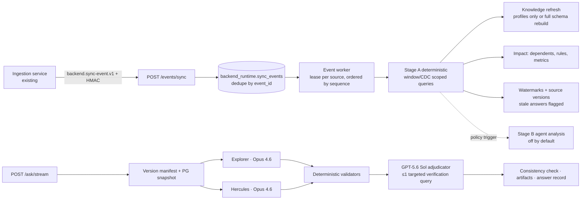

# Backend Runtime: event-driven agent pipeline and frontend

This guide covers the runtime layer that sits between the existing ingestion/synchronization service and the reasoning engine. It also covers the React frontend's live mode. Nothing in the ingestion service was recreated; the backend only consumes the events that service publishes.

## Start it locally

```powershell
pip install -r requirements.txt
copy .env.example .env                 # optional: Foundry endpoint + key, event secret, sandbox provider
python scripts/build_dataset.py        # first run only: synthetic finance warehouse
python scripts/build_knowledge.py      # first run only: ontology / knowledge graph
powershell -ExecutionPolicy Bypass -File scripts\start_dev.ps1
```

Or start the pieces by hand:

```powershell
python -m uvicorn backend.api.app:app --port 8000      # API + background event worker
cd frontend; npm install; npm run dev                # http://localhost:5173 (live mode)
```

The UI itself is unchanged. Live mode feeds the original screens from the backend through `frontend/src/live/adapter.ts`; `VITE_BACKEND_MODE=demo` brings back the scripted mockup data.

| Screen | Live data |
|---|---|
| Home | Composer posts to `/ask/stream`. The paperclip uploads files and opens a workspace for the next questions. "N sources" and "handled N things" are real counts. Suggestions are questions the warehouse can answer |
| Thread | Same step list, source cards, answer, KPI tiles, callouts, table and agent-conflict box. Steps advance on real graph node events; details come from manifest, tool, candidate and verdict events. The Actions tab lists downloadable artifacts. Share downloads the first artifact |
| Autopilot | Live feed = sync events plus their investigations. Standing goals = one per source with its sync status |
| Activity log | Saved answers, sync events and investigations, newest first. Clicking an answer re-asks it |
| Sources | `/runtime/sources` (type, collections, data version, last sync, stale on failed sync) |
| Notifications | Investigation timeline and real counts |
| Sidebar | Library = recently saved answers |

Approvals and Settings keep their original content: the backend has no action-execution or guardrail API, so live mode creates no actions and Approvals shows "You're all caught up".

### HubSpot ingestion (`knowledge-ingestion/`)

`scripts/start_dev.ps1` also starts the ingestion service on port 8001 when `knowledge-ingestion/.env` exists. It polls HubSpot, writes `hubspot.contacts` and `pipeline_crm.prospect_accounts` into the warehouse database, and publishes signed sync events to `BACKEND_EVENTS_URL` (http://localhost:8000). Both `.env` files need the same `BACKEND_EVENT_SECRET`. The backend exposes these tables as the `hubspot` source, and `finance_pg` hides the `hubspot` and `public` schemas, which hold the service's own bookkeeping tables, including raw HubSpot payloads.

How the two systems stay consistent:

* **Same customers.** The HubSpot test portal's companies are real customers in the synthetic warehouse: Contoso Logistics, Woodgrove Bank, Northwind Traders, Adatum Systems and Litware Pvt Ltd are customer groups with contracts and invoices; Fabrikam Retail (an opportunity in HubSpot) is a prospect with open deals only. The generator renames existing groups after its random draws, so every amount, date and ID, and every invariant, is unchanged (`HUBSPOT_GROUP_NAMES` in `backend/synthetic/generator.py`).
* **Linking, not duplicating.** The loader links each HubSpot company, and each contact's company, to the CRM account that already represents it. Matching uses the account name, the customer group name or a verified counterparty alias, ignoring legal suffixes. Links are stored in `hubspot.company_links` and `hubspot.contacts.crm_account_id`. Only unmatched companies become new prospects.
* **One owner per field.** HubSpot owns account names and lifecycle; finance owns invoices, contracts and amounts. `is_existing_customer` is true when HubSpot has a customer-stage contact or the customer group has a signed contract, so the two never disagree about who is a customer.
* **Events name what changed.** Sync events list changed contacts by HubSpot ID, and changed accounts by their CRM account ID: created, renamed or customer flag flipped.

## Flow



## Intent agent (first step for every question)

`understand_intent` runs before anything else (`backend/agents/intent.py`). It has the same read-only knowledge tools as Explorer and Hercules, read-only SQL, and a fixed capability list (`backend/agents/capabilities.json`). It submits one schema-checked decision:

| Route | When | What happens |
|---|---|---|
| `answer` | Greetings, "what can you do?", which data or fields exist, freshness, how answers are verified | Answered directly in a few seconds. No agents, exports or saved answer. If it ran a lookup query, the answer is labelled *not dual-verified* |
| `clarify` | A data question that needs a choice only the user can make (which year, which revenue definition) | One short question with 2–4 options from the catalog. The UI shows the options as follow-ups |
| `investigate` | Any business figure (totals, counts, rankings, comparisons) | The usual Explorer + Hercules path. Both agents get the intent agent's brief as a starting hint, not evidence |

When unsure, it chooses `investigate`. Without an LLM it uses deterministic rules that only answer obvious conversational and catalog questions. Single-agent runs (`mode=explorer|hercules`) skip it.

Verified live: "what can you do?" was answered in 7 s and "What was our revenue last year?" got a clarifying question in 6 s. "Is Contoso Logistics a customer, which region?" was answered in 12 s with one lookup, labelled not dual-verified. "How many OVERDUE invoices?" went to both agents and came back 13, verified, in 46 s.

## Data preparation (the only agent with a sandbox)

Every uploaded file and every HubSpot batch is checked by the data-prep agent (Claude Opus 4.6, model role `prep`) in the Daytona sandbox **FinSight** before anyone uses it (`backend/prep/`). Explorer and Hercules have no Python tool.

1. **Profile:** the file is uploaded to a per-job folder in the sandbox and checked against its hash. A profiling script (pandas) measures, per column, missing values, stray spaces, number and date parse rates, ambiguous day/month dates, case variants, outliers, repeated ids, and identical rows.
2. **Plan:** the agent may investigate with Python in the sandbox, then submits findings and fixes built from a fixed set of operations: trim, standardize case, convert to numbers or dates, map values, fill missing values (median, mean, mode, constant, forward-fill), flag duplicates, drop identical rows, drop rows missing values.
3. **Apply:** code, not the model, decides what needs a person. Trimming, case, flags, filling missing values (imputation), value mappings and lossless number/date conversions are applied in the sandbox without asking, and the cleaned file is downloaded as a **new version**; the original is never modified. For uploaded files, only fixes that remove rows or would leave values blank (numbers that do not all parse, day/month-ambiguous dates) go to the **Approvals** screen.
4. **Decide:** in the chat, attached files show a card with what was fixed and Approve / Reject buttons for anything that needs a person (the same items are in the Approvals screen). When every pending fix of a job is decided, the approved ones are applied in the sandbox to a further version. Conversations using the file switch to it, and their workspace is rebuilt on the next question.

Duplicates are never removed automatically. Repeated rows can be real, for example a subscription billed twice, so they are flagged in the file (`_duplicate_group`, `_duplicate_count`) and explained in a finding; removal is only ever proposed. Without a model, the fallback rules fill only numeric gaps (median); names, titles and emails are facts and stay missing.

**HubSpot:** knowledge-ingestion sends each batch to `POST /prep/batches` before loading it, signed with the event secret. The data-prep agent checks it in the sandbox and **every fix is applied without approval**, including fills; the cleaned records are returned and loaded. Drop operations are skipped for CRM data so the database keeps every record HubSpot has (the record is loaded and the finding explains the problem). If the check fails, the run fails and the same records are checked again on the next poll. (`POST /prep/batches/released` and `/ack` remain for batches held under the previous rules.)

Endpoints: `POST /prep/files`, `GET /prep/jobs`, `GET /prep/jobs/{id}`; approval decisions on data-prep fixes go through the usual `POST /approvals/{id}/decision`. Settings: `DAYTONA_API_KEY`, `DAYTONA_API_URL`, `DAYTONA_TARGET`, `DAYTONA_SANDBOX` (default `FinSight`), and `BACKEND_PREP_SANDBOX=daytona|local`. `local` runs the same scripts in a local process: tests only, not isolation.

Verified live: Opus 4.6 in FinSight took 58 s on a messy subscriptions file. It trimmed vendors, standardized mixed date formats and region case, and converted amounts. It did not invent two missing amounts, and flagged a double-billed subscription as critical, proposing its removal only for approval.

## Spend leakage hunting (Problem Statement #15)

Leakage hunting is a capability of the same agent, not a separate tool (`backend/leakage/`). It reads the `procurement` schema in `aethelgard_finance`, which holds suppliers, contracts, rate cards, purchase orders, invoices, invoice lines, payments, SaaS subscriptions and seat usage. Suppliers are shared with the existing client groups through `conglomerate_id`.

1. **Detect:** five read-only detectors run through the gateway:
   - duplicate invoices: same supplier and amount, within 30 days, different invoice numbers;
   - prices above the contracted rate, honouring escalation clauses by effective date;
   - early-payment discounts that were missed;
   - payments above the invoice amount;
   - SaaS seats unused for 60 days or more.

   Legitimate exceptions are excluded: credit-noted duplicates, approved price exceptions, recurring monthly fees, seats inside a notice period, and discounts captured in time.
2. **Investigate:** every case carries its evidence rows, a root cause in plain language, and a confidence score.
3. **Prioritise:** cases are ranked by recoverable value times confidence.
4. **Recover:** each new case gets a drafted action in **Approvals**: a claw-back, refund or credit-note request, a discount recovery, a payment hold for an unpaid duplicate, or a seat reduction. Nothing is sent until a person approves. Then the request goes to the mock AP / ERP API (`backend_runtime.mock_ap_requests`); a payment hold blocks the unpaid invoice there. Rejecting a draft dismisses the case.

It runs on its own. A sweep runs every `BACKEND_LEAKAGE_SWEEP_S` seconds (default 900; 0 disables it), and a scan runs whenever a sync event changes a `procurement.*` collection. Repeated scans update cases rather than duplicating them, and a case that is no longer detected (for example after a credit note) becomes `resolved`.

Cases are stored in `backend_runtime.leakage_cases` and registered as the read-only `leakage` source, so the agents answer questions like "which suppliers leak the most?" with the usual verification. In the UI, the Autopilot screen shows one goal per leakage type, totals for leakage detected, items awaiting approval and value recovered, and a case feed. Clicking a goal asks the agent about those cases.

**Data and acceptance:** `scripts/load_procurement.py` generates the procurement data (seed 20261024) and writes `benchmark/leakage_answer_key.json`. That file lists 38 seeded cases worth $1,288,238.09 and 10 legitimate look-alikes. The brief requires at least 80% detection and at most 10% false positives. The detectors find all 38 with exact values, flag no legitimate look-alikes, and have 0 false positives (`tests/test_leakage.py`, `backend/leakage/evaluation.py`).

Endpoints: `POST /leakage/scan`, `GET /leakage/summary`, `GET /leakage/cases?status=`, `GET /mock-ap/requests`; decisions go through `POST /approvals/{id}/decision`.

**Uploaded files.** Asking "find the leaks in these files" with files attached runs the same detectors on whatever AP exports were uploaded (`backend/leakage/ledger.py`):
1. Each file gets a role (vendors, contracts, price list, purchase orders, invoices, invoice lines, payments, credit notes, licences, licence activity, FX rates, or ignore) and its columns are mapped to the canonical ledger. Header synonyms and file-name hints propose the mapping; with a model configured (role `ledger`, GPT-5.6 Sol) it is reviewed with column samples, and fields must name real columns.
2. Dates and amounts in any common format are parsed, vendors are resolved by id, tax id or name variant, payments are linked to invoices through an id column or a free-text reference, full credit notes reverse invoices, foreign-currency invoices are converted with the uploaded FX rates, and annual licence prices become monthly. Anything not read or linked is reported in the answer.
3. The canonical tables are loaded into an in-memory DuckDB under schema `procurement` and the detectors run unchanged. The answer lists every case with its evidence and says which files were read and which were not used. The normalised ledger (`ledger_*`) and `leakage_findings` are then added to the conversation's files, so follow-up questions can use them.

Test files (`python scripts/make_test_files.py`): `test_files/leakage_audit_pack/` holds 14 messy AP files to upload together (two ERP invoice exports, scanned invoices, a bank statement with free-text references and refunds, credit notes, a superseded contract, an overlapping price renewal, an INR supplier with FX rates, licences and user activity, gaps to fill, and an unrelated journal extract). The answer key is `test_files/leakage_audit_pack_answer_key.json`: 55 seeded cases worth $1,664,796.37 and 27 legitimate look-alikes. Verified live (Opus data prep in Daytona, then the chat): 55/55 detected with the right values, 0 false positives, no look-alike flagged. `test_files/approval_test/vendor_payments_review.(csv|xlsx)` contains problems that need a person (ambiguous dates, amounts typed as text, rows without an id, exact duplicates); the decisions appear in the chat.

## Conversations

Every question belongs to a conversation, stored in PostgreSQL (`backend_runtime.conversations` and `backend_runtime.messages`; code in `backend/runtime/conversations.py`).

* `/ask` and `/ask/stream` accept `conversation_id`. Without one, a new conversation is created and its id is returned (the stream sends it first as a `conversation` event).
* The last six turns go to the intent agent. For data questions it writes a **standalone question** ("and its average price?" becomes "What is North Pit's average price…") that the agents and validators use; the UI still shows what the user typed.
* A conversation remembers its attached files. Workspaces are held in memory, so after a restart the conversation's workspace is recreated from those files automatically.
* `GET /conversations` lists the user's conversations, `GET /conversations/{id}` returns its messages and files, and `DELETE /conversations/{id}` removes it. Conversations are private to their tenant and user.
* In the UI, the sidebar Library lists conversations; opening one shows its earlier turns, and follow-ups continue it. "New goal" starts a fresh conversation. Attached files show as chips in the chat box.

## Event contract (proposal)

The contract is a **proposal to agree with the ingestion engineer**. The backend does not assume the producer already emits it. JSON Schema: [`docs/events/sync-event.v1.schema.json`](events/sync-event.v1.schema.json). Model: `backend/events/contracts.py`.

```json
{
  "schema": "backend.sync-event.v1",
  "event_id": "sync-2026-10-23T10:05:00Z-finance_pg-42",
  "event_type": "database.sync.completed",
  "tenant_id": "default",
  "source_id": "finance_pg",
  "collections": [
    {"name": "finance.sales_invoices", "timestamp_column": "updated_at", "expected_changes": 3,
     "changes": [{"op": "update", "key": {"invoice_id": 1017}, "changed_columns": ["settlement_status"],
                  "before": {"settlement_status": "OPEN"}}]},
    {"name": "finance.customer_payments", "timestamp_column": "updated_at", "schema_changed": false}
  ],
  "window_start": "2026-10-23T10:00:00Z",
  "window_end": "2026-10-23T10:05:00Z",
  "data_version": "v42",
  "sequence": 42,
  "status": "completed"
}
```

Producer obligations:

* Publish only after the window's transactions are committed and visible to readers.
* Windows are half-open (`[start, end)`), and consecutive windows share a boundary.
* `sequence` (or the digits of `data_version`) increases monotonically for each tenant, source and database.
* Sign the raw body: `X-Backend-Signature: hex(HMAC-SHA256(BACKEND_EVENT_SECRET, body))`. Unsigned events are rejected with HTTP 401 unless `BACKEND_EVENT_ALLOW_UNSIGNED=1`.
* CDC keys (`changes[]`) are optional but preferred. With keys, the backend queries exactly those rows. Without them it falls back to the timestamp window, which can detect inserts, updates and tombstoned deletes but cannot reconstruct before-values.

Event types are `database.sync.completed` (status `completed` or `partial`, with per-collection status), `database.sync.failed`, and `knowledge.version.published` (forces a knowledge refresh).

## How events are processed

| Concern | Behaviour | Code |
|---|---|---|
| Authenticity / validation | HMAC check, then Pydantic validation; invalid bodies get 400 and nothing is stored | `backend/events/consumer.py` |
| Duplicates | `event_id` primary key; a duplicate is acknowledged as `duplicate` and not reprocessed | `backend/events/store.py` |
| Ordering / concurrency | Claims the lowest `sequence` per source with `FOR UPDATE SKIP LOCKED`. Only one live lease per source; expired leases are reclaimed after a crash or restart | `RuntimeStore.claim_next` |
| Out-of-order / overlapping windows | Watermarks are stored as merged interval sets, so an older or overlapping window only fills its gap. The source version never regresses | `RuntimeStore.cover`, `advance_version` |
| Gaps | Reported in the investigation (`gaps`) until a later event covers them | `cover()` |
| Late rows | The window is re-read with a `lookback_s` margin (default 300 s); late rows are counted separately | `ChangeInvestigator._window` |
| Not yet visible | If CDC keys or `expected_changes` aren't visible yet, the event is deferred with backoff. After `max_visibility_retries` it fails with `visibility_timeout`. The watermark doesn't move | `NotYetVisible` |
| Failed sync | `database.sync.failed` or a failed collection marks the source `sync_failed`. Watermark and version are untouched; answers on that source carry a freshness warning | `mark_sync_status` |
| Missing / wrong timestamp column | The collection is reported as `unverifiable_window` or `invalid_timestamp_column`, and its watermark is not advanced | `_investigate_collection` |
| Deletes | Via CDC `op=delete` (verified absent), or via tombstone columns discovered in the schema (`is_deleted`, `deleted_at` and similar) | |
| Restart safety | An event is marked `processed` only after its investigation record is written. Reprocessing is idempotent | `EventConsumer.process_one` |

**Stage A (always, deterministic, no LLM):** scoped queries per changed collection (parameterized `IN` on the CDC keys, or the bounded timestamp window); schema drift against the knowledge graph; impact through *verified* `REFERENCES` edges (affected parents, dependent children with counts) and `DERIVED_FROM` reconciliation rules; affected metrics. It never runs a full-database scan.

**Stage B (policy-gated):** runs agent analysis only when a trigger fires: a watched analysis covering a changed collection, a change-volume anomaly (`anomaly_ratio`, `anomaly_min_rows`), or unresolved relationships (opt-in). Even then it runs only if `auto_analysis` is on (off by default, `BACKEND_AUTO_ANALYSIS=1`). Ordinary record updates never spend Opus calls. Stage B answers are stored in the investigation record (`stage_b`); they are never promoted into the ontology as verified facts.

Example `BACKEND_RUNTIME_POLICY` file:

```json
{
  "timestamp_columns": {"finance_pg": {"finance.journal_lines": "posted_at"}},
  "lookback_s": 300,
  "auto_analysis": false,
  "anomaly_ratio": 5.0,
  "anomaly_min_rows": 50,
  "watched": [{"analysis_id": "overdue", "question": "How many invoices are overdue?",
               "sources": ["finance_pg"], "collections": ["finance.sales_invoices"]}]
}
```

## Knowledge integration

* **Data-only change:** re-profiles only the changed collections, then regenerates only their skill reference files. Other files are carried forward with `carried_forward_from` front matter. The ontology is **not** rebuilt.
* **Schema change** (flagged by the producer or detected as drift): `prepare_source(force=True)` rebuilds that source's ontology; old knowledge is marked `stale_schema` by fingerprint.
* **Always:** per-source caches are invalidated, and stored answers that touched a changed table are marked stale (`GET /runtime/answers`).
* **Uploads:** files go to a content-addressed file store. A workspace (`POST /workspaces`) gets its own source and knowledge namespace (`<tenant>::ws::<id>`), so uploads never modify the persistent database ontology. Deleting the workspace removes that namespace.

## Versions and consistency

Each question resolves a **version manifest**: for every source, its `data_version`, `sequence`, last sync time, sync status, schema version, knowledge version and consistency mode, plus a digest. The manifest is streamed to the UI and given to both agents.

* PostgreSQL sources: one exported snapshot (`pg_export_snapshot`) is held for the run, and every agent query uses `SET TRANSACTION SNAPSHOT`. Both agents and the verification queries therefore read the same data even while a sync commits mid-question.
* Other sources (DuckDB files, Mongo, REST): `detect_only`. Versions are compared at the end; if they changed, the run is retried once (`BACKEND_RETRY_ON_VERSION_CHANGE`). If it still differs, the answer carries `changed_during_run`.
* Statuses: `consistent`, `snapshot_consistent_but_outdated` (a newer version landed after the snapshot was taken), and `changed_during_run`.

## Models (Microsoft Foundry)

Routing policy: the two investigating agents do the important work, so both use the strongest model. Structured outputs go to the OpenAI model. Sonnet is reserved for lightweight understanding and summarisation tasks.

| Role | Default deployment | Route | Override |
|---|---|---|---|
| Explorer | `claude-opus-4-6` | `/anthropic/v1/messages` | `BACKEND_EXPLORER_LLM_MODEL` |
| Hercules | `claude-opus-4-6` | `/anthropic/v1/messages` | `BACKEND_HERCULES_LLM_MODEL` |
| Intent agent (first step) | `gpt-5.6-sol` | `/openai/v1/chat/completions` | `BACKEND_INTENT_LLM_MODEL` (falls back to the structured role) |
| Structured output (adjudicator verdict) | `gpt-5.6-sol` | `/openai/v1/chat/completions` | `BACKEND_STRUCTURED_LLM_MODEL` (or `BACKEND_ADJUDICATOR_LLM_MODEL`) |
| Light tasks | `claude-sonnet-5` | `/anthropic/v1/messages` | `BACKEND_LIGHT_LLM_MODEL` |

The light role is configured, but no pipeline step calls an LLM for lightweight work yet: question parsing, Stage A and summaries are deterministic. Both agents now run on the same model, so their independence comes from different strategies, contexts and prompts (tool-driven exploration versus compressed full context) rather than different model families.

The endpoint and key come from `BACKEND_FOUNDRY_ENDPOINT` and `BACKEND_FOUNDRY_API_KEY`. Any `BACKEND_<AGENT>_LLM_<NAME>` setting (provider, base URL, key, timeout, retries, max tokens, prices) overrides the global value. System prompts are in `backend/agents/prompts.py`. `python scripts/probe_foundry.py` checks the deployments without printing secrets. `GET /runtime/models` shows what is active.

The GPT adjudicator sees both candidates, the deterministic validator findings, the manifest and the consistency status. It may request **one** targeted read-only verification query (run through the same SQL guard and snapshot) before its final verdict. Guards: it can't select a candidate that has blocking validator errors or no result; question ambiguity stays unresolved; final values always come from an executed candidate, never from model text.

## Sandboxes, files and artifacts

* `POST /files` (multipart) stores files with a sha256 hash, an extension allow-list and a size limit, scoped to tenant and user. `GET /files/{id}/download` re-verifies the hash on read.
* `run_python` is offered to the agents only when `BACKEND_SANDBOX` is `local` or `daytona`. A sandbox is created lazily, one per run and agent, the first time an agent calls the tool. Files are uploaded explicitly and their hash is verified inside the sandbox; nothing is assumed to be present. Files written to `out/` become artifacts. Sandboxes are deleted when the run finishes.
* `local` uses a subprocess with a stripped environment. It is **not a security boundary** and is for development only. `daytona` uses the Daytona SDK (`DAYTONA_API_KEY`).
* Exports and sandbox outputs are registered as artifacts and returned with the answer; `GET /artifacts/{id}/download` serves them.

## API added in this phase

| Method | Path | Purpose |
|---|---|---|
| POST | `/events/sync[?process=true]` | Event ingress (401 bad signature, 400 invalid, `duplicate` on replay) |
| GET | `/runtime/sources` | Per-source freshness: version, sequence, sync status, watermark, schema/knowledge version |
| GET | `/runtime/events`, `/runtime/investigations` | Event log and Stage A/B investigation records |
| GET | `/runtime/answers` | Stored answers, flagged stale when their tables changed |
| GET | `/runtime/models` | Active model per agent and sandbox provider |
| POST/GET | `/files`, `/files/{id}/download` | Uploads with integrity checks |
| GET | `/artifacts`, `/artifacts/{id}/download` | Generated outputs |
| POST/GET/DELETE | `/workspaces` | Upload-scoped analysis sessions |
| POST | `/ask/stream` | SSE: `node`, `manifest`, `started`, `tool`, `model_text`, `submission`, `candidate`, `verification`, `verdict`, `retry`, `result` / `error` events (`workspace_id` and `sources` are accepted) |

Identity is taken from the `X-Tenant-Id` / `X-User-Id` headers, as in the existing API. There is no user authentication in front of the API yet.

## Tests

```powershell
python -m pytest tests -q                                   # offline: LLM and sandbox mocked/disabled
$env:BACKEND_LIVE_SMOKE="1"; python -m pytest tests/test_live_smoke.py -q   # real Foundry calls (costs tokens)
cd frontend; npm run build                                  # TypeScript type check + production build
```

Stop a running dev backend before running the suite. Its event worker polls the same runtime store and can claim the test events.

`tests/test_runtime.py` runs against a real Postgres scratch database (`backend_sync_lab`). It covers:

* contract, signature and duplicates;
* single- and multi-collection events, and data-only versus schema changes;
* dependents outside the changed set;
* out-of-order and overlapping windows, and gaps;
* missing and wrong timestamp columns;
* CDC and tombstone deletes;
* visibility deferral and failed syncs;
* lease recovery after a restart;
* snapshot consistency while a sync commits mid-question;
* stale context and stale answers;
* Stage B policy gating;
* the LLM adjudicator, using a scripted provider for verification and its guards;
* routing disagreements to the adjudicator;
* sandbox file integrity, artifacts and failures (a Daytona fake and a real local subprocess);
* API streaming, uploads, workspaces, artifacts and event ingress.

## Status

**Implemented and tested**

* Event contract, HMAC auth, durable store, dedupe, per-source ordering, leases, deferral and retry, restart safety.
* Interval watermarks covering out-of-order, overlapping, gap and late-row cases.
* Stage A scoped investigation (CDC keys and windows, deletes, schema drift, dependents, rules, metrics).
* Stage B policy gating.
* Targeted knowledge refresh, cache invalidation and stale-answer flags.
* Version manifests, Postgres snapshot consistency, and retry on version change.
* Per-agent Foundry models with the specified prompts. Verified live with Opus 4.6 on both agents: both answered 13 for "How many invoices have settlement status OVERDUE?", which matches the database, using the same SQL and a consistent snapshot. GPT-5.6 Sol selected the result in about 46 s. Explorer used about 24.5k input tokens and Hercules about 35.2k.
* GPT adjudicator with one targeted verification query, plus guards.
* File store, workspaces, artifacts and the local sandbox.
* The new API endpoints.
* Frontend integration into the existing screens without UI changes: streamed thread, sources and freshness, change feed, activity log, uploads to workspaces, artifact download. The frontend type-checks, builds and lints (warnings only, the same kinds as the original code). The endpoints it polls were checked against a running backend over HTTP; it has not been clicked through with browser automation.

**Partial**

* **Daytona:** implemented against the SDK and tested with a fake client only. There was no `DAYTONA_API_KEY`, so it has never run against real Daytona.
* **Consistent snapshots:** PostgreSQL only. DuckDB, Mongo and REST use detect-and-retry.
* **Cost reporting:** shows $0 unless `BACKEND_*_LLM_*_COST_PER_MTOK` prices are configured. Token counts are real.
* **Streaming:** events stream; model tokens do not.
* **Workspace sessions:** held in memory and lost on API restart. Their files persist in the file store.
* **Event contract:** a proposal not yet agreed with the ingestion engineer.
* **Flaky test:** `test_concurrent_sync_during_question_uses_consistent_snapshot` failed once in many runs. The cause was not found.

**Not implemented**

* User authentication or authorization in front of the API (tenant and user are trusted headers).
* A push channel (WebSocket or SSE) for changes; the app polls the runtime endpoints every 5 seconds.
* Approvals and Settings have no backend (no action execution or guardrail API); in live mode they show their original static content.
* Stage B results are not surfaced as proactive notifications.
